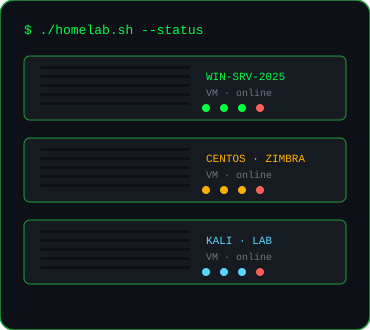

<div align="center">



<br/><br/>



<br/><br/>


<br/><br/>

<h3><code>royer@github ~ $ whoami</code></h3>

<table>
  <tr>
    <td valign="top"></td>
    <td valign="top"></td>
  </tr>
</table>

<br/>


</div>

---

## 🕹️ `PLAYER_1.profile`

```diff
+ class Royer:
+     nombre      = "Royer Díaz"
+     clase       = "Ingeniero de Sistemas en construcción 🛠️"
+     nivel       = "Nivel secreto: universidad y ciclo clasificados 🤫"
+     stack       = ["Python", "Java", "Spring Boot", "Angular", "SQL Server"]
+     infra       = ["Windows Server 2025", "CentOS", "Kali Linux", "Zimbra", "Samba"]
+     aprendiendo = ["Big Data", "Arquitectura de servidores", "Seguridad informática"]
+     mision      = "Convertir cada laboratorio en un proyecto real"
+
+ >>> ¡Gracias por visitar mi perfil! 🎮
```

---

## ⚡ `INVENTARIO.stack`

<div align="center">

**💻 Desarrollo**


**🗄️ Datos**


**🖥️ Sistemas y virtualización**


**🛠️ Herramientas**


</div>

---

## 🚀 `MISIONES.activas`

| Misión | Descripción | Tech |
|:--|:--|:--|
| 🅿️ **Estacionamiento automatizado** | Sistema que automatiza el control de un estacionamiento y analiza los datos generados | `Python` `Big Data` |
| ☕ **App web full stack** | Backend con API REST y frontend moderno, conectados a una base de datos propia | `Java` `Spring Boot` `Angular` `SQL` |
| 🏢 **Infraestructura virtualizada** | Dominio y servicios sobre Windows Server 2025 con clientes Windows 11 | `Windows Server` `Windows 11` |
| ✉️ **Servidor de correo corporativo** | Mensajería propia desplegada y configurada desde cero | `Zimbra` `CentOS` |
| 📁 **Servidor de archivos** | Recursos compartidos entre sistemas Windows y Linux | `Samba` `CentOS` |
| 🕵️ **Laboratorio de seguridad** | Entorno aislado para practicar pruebas de seguridad de forma ética | `Kali Linux` |

---

## 📊 `STATS.exe`

<div align="center">


</div>

---

## 📬 `CONTACT.me`

<div align="center">

[](https://www.linkedin.com/in/royerdiaz/)

<br/>

```
> GAME OVER? ...nunca. Siempre hay otro nivel. 🎮
```


</div>
