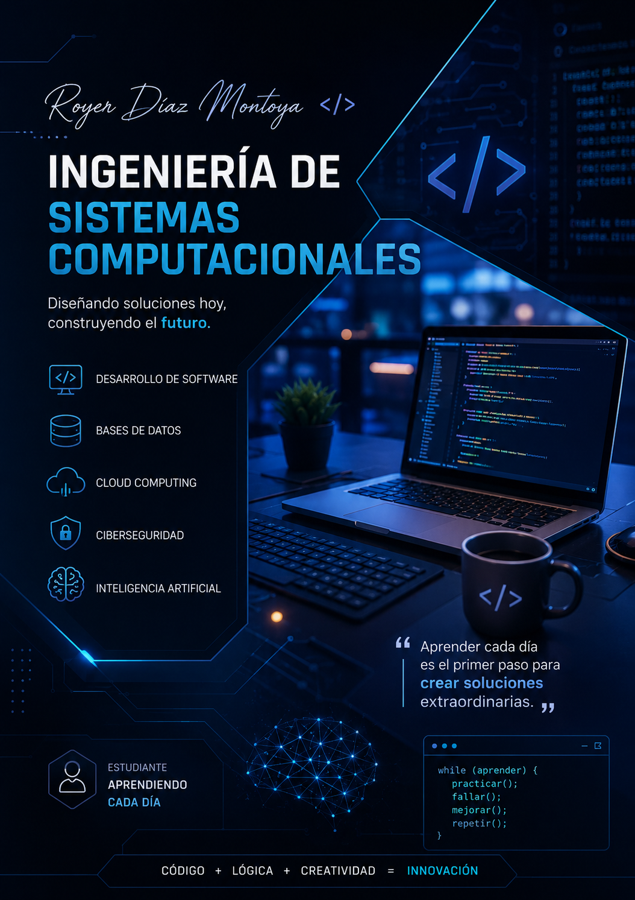
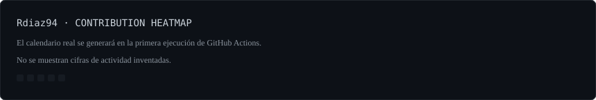
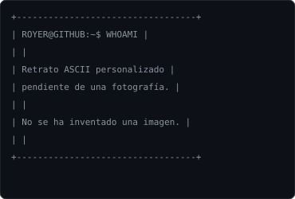

# Royer Díaz Montoya

### <code>royer@github ~ $ whoami</code>

**Estudiante de Ingeniería de Sistemas Computacionales · Perú 🇵🇪**

Aprendiendo y construyendo proyectos de software, datos e infraestructura.

---

### <code>royer@github ~ $ ./contributions.sh</code>

 

### <code>royer@github ~ $ neofetch</code>

<table>
<tr>
<td valign="top" width="42%">

</td>
<td valign="top" width="58%">

</td>
</tr>
</table>

---

## <code>~/stack</code>

  

- **Lenguajes:** Python, Java, C#
- **Desarrollo web:** HTML, CSS, JavaScript
- **Bases de datos:** SQL Server, MySQL, PostgreSQL
- **Herramientas:** Git, GitHub, VS Code, Visual Studio, Docker
- **Sistemas y cloud:** Linux, Windows, Azure, AWS

## <code>~/projects</code>

| Proyecto | Descripción | Tecnologías |
|---|---|---|
| 🏥 Sistema de Gestión Hospitalaria | Gestión de pacientes, historias clínicas y consultas. | Java, SQL Server |
| 🖥️ Infraestructura Virtualizada | Laboratorio con Active Directory, DNS, DHCP, IIS y políticas de grupo. | Windows Server, VirtualBox |
| 📊 ETL Salud BI | Procesamiento y limpieza de datos abiertos. | Python, Pandas |
| 🎮 OpenGL Visualizer | Proyecto de computación gráfica. | C++, OpenGL |

> Los enlaces a cada proyecto se añadirán cuando estén identificados sus repositorios públicos.

## <code>~/currently-learning</code>

- Python y desarrollo de software
- Bases de datos y modelado de información
- Linux e infraestructura cloud
- Inteligencia artificial y ciberseguridad

## <code>~/goals</code>

- Crear proyectos que resuelvan problemas reales.
- Mejorar la calidad, documentación y mantenibilidad del código.
- Conseguir experiencia profesional y contribuir a proyectos open source.

---

<code>echo "Gracias por visitar mi perfil"</code>

*El conocimiento crece cuando se comparte.*

